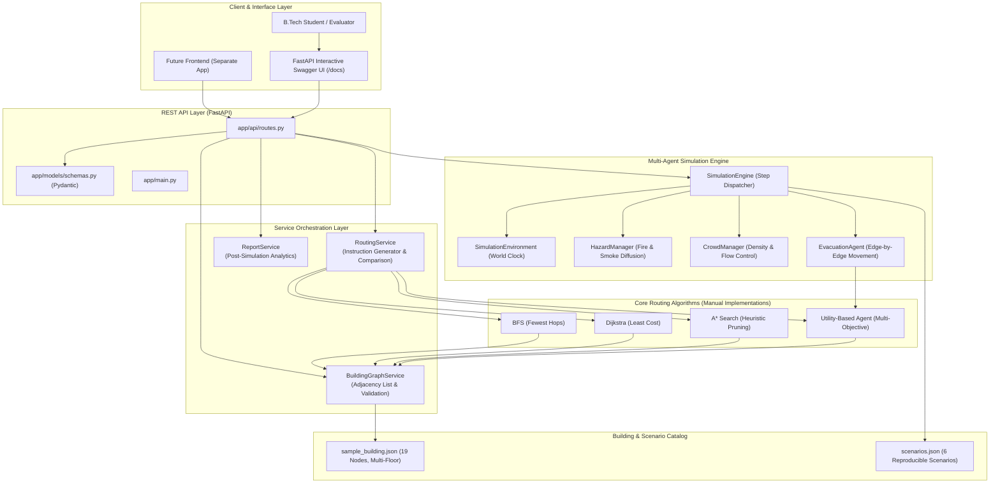

# Comprehensive Project Guide & Academic Reference Manual

**Project Title:** Emergency Evacuation Planning System — An Intelligent Multi-Agent Route Optimization and Hazard Simulation System  
**Academic Target:** B.Tech Computer Science & Engineering (AI / Algorithms Final & Pre-Final Year Project)  
**Author / Engineering Mentor:** Senior AI Engineer & Software Architect  

---

> ### ⚠️ Mandatory Academic Disclaimer
> **ACADEMIC NOTICE:** This project is an educational AI research, algorithmic demonstration, and simulation platform. It is **NOT** certified for life-critical building safety engineering, regulatory fire code compliance, or real-world emergency dispatch. Real-world evacuation decisions must always adhere to designated civil defense authority protocols, certified building fire safety systems, and official emergency personnel instructions.

---

## Table of Contents
1. [Section A: Project Introduction](#section-a-project-introduction)
2. [Section B: Complete System Architecture](#section-b-complete-system-architecture)
3. [Section C: Graph Theory Fundamentals](#section-c-graph-theory-fundamentals)
4. [Section D: Every Algorithm in Simple English](#section-d-every-algorithm-in-simple-english)
   - [D.1 Breadth-First Search (BFS)](#d1-breadth-first-search-bfs)
   - [D.2 Dijkstra's Algorithm](#d2-dijkstras-algorithm)
   - [D.3 A* Search Algorithm](#d3-a-search-algorithm)
   - [D.4 Utility-Based Intelligent Agent](#d4-utility-based-intelligent-agent)
5. [Section E: Mathematical Formulas & Numerical Examples](#section-e-mathematical-formulas--numerical-examples)
6. [Section F: Utility-Based Agent Decision Engine](#section-f-utility-based-agent-decision-engine)
7. [Section G: Multi-Agent Simulation Engine](#section-g-multi-agent-simulation-engine)
8. [Section H: Dynamic Hazard Simulation & Progression](#section-h-dynamic-hazard-simulation--progression)
9. [Section I: REST API Guide](#section-i-rest-api-guide)
10. [Section J: How to Install, Test, and Run (Windows Guide)](#section-j-how-to-install-test-and-run-windows-guide)
11. [Section K: Step-by-Step Demonstration Scenarios](#section-k-step-by-step-demonstration-scenarios)
12. [Section L: Code Modification Guide](#section-l-code-modification-guide)
13. [Section M: Viva Preparation & Defense Strategy](#section-m-viva-preparation--defense-strategy)
14. [Section N: Honest Project Assessment & Future Work](#section-n-honest-project-assessment--future-work)

---

## Section A: Project Introduction

### A.1 What This Project Does
The **Emergency Evacuation Planning System** is a full-featured AI simulation and route optimization engine designed to safely navigate occupants out of complex, multi-floor buildings during critical emergencies (such as fires, toxic smoke spread, structural blockages, or flash flooding).

Rather than simply choosing the shortest geometric path to a door, this system models a **living building environment**:
- Hazards expand and intensify over time.
- Hallways become congested when multiple groups attempt to evacuate simultaneously.
- Wheelchair users cannot traverse staircases and require step-free accessible routes.
- Impassable blockages trigger instant, autonomous dynamic route recalculations.

### A.2 Why Emergency Evacuation Planning Is Important
During architectural emergencies, the leading cause of casualties is often not the initial trigger, but **evacuation bottlenecks, stampedes, and occupants unknowingly walking directly towards spreading hazards**. Traditional static emergency exit signs point in fixed directions regardless of where a fire has broken out. An intelligent evacuation system perceives the location of hazards in real-time and computes dynamic, risk-averse escape trajectories.

### A.3 What Makes This Different From Basic Shortest-Path Programs
A basic introductory shortest-path program calculates the static Euclidean or graph distance between Point A and Point B. This project differs fundamentally in five ways:
1. **The Shortest Path Is Not Always the Safest Path:** A 20-meter smoke-filled corridor is rejected in favor of a 35-meter clean corridor.
2. **Multi-Exit Goal Selection:** The system does not require hardcoding a target exit; it dynamically discovers the least-cost reachable exit among multiple alternatives.
3. **Multi-Agent Crowd Dynamics:** Groups traversing hallways contribute to localized density, slowing down movement and causing subsequent groups to divert to alternate corridors.
4. **Hard Accessibility Constraints:** Wheelchair mobility profiles enforce strict elimination of stairways, directing occupants to certified external evacuation ramps.
5. **Dynamic Real-Time Replanning:** When an ongoing emergency blocks an agent's assigned path mid-evacuation, the agent autonomously replans its escape.

---

## Section B: Complete System Architecture

### B.1 High-Level Architecture Diagram (Mermaid)



### B.2 Directory Structure & Module Responsibilities

```
d:/Ai_Project/
├── frontend/                     # Completely reserved for future frontend
│   └── .gitkeep                  # Preserves folder in Git without code
├── app/
│   ├── __init__.py               # Package marker
│   ├── main.py                   # FastAPI initialization, CORS, OpenAPI setup
│   ├── api/
│   │   ├── __init__.py
│   │   └── routes.py             # HTTP endpoint definitions (/route, /simulate, etc.)
│   ├── models/
│   │   ├── __init__.py
│   │   └── schemas.py            # Pydantic schemas for graph, agents, and hazards
│   ├── algorithms/
│   │   ├── __init__.py
│   │   ├── bfs.py                # Manual unweighted Breadth-First Search
│   │   ├── dijkstra.py           # Manual priority-queue Dijkstra algorithm
│   │   ├── astar.py              # Manual A* search with 3D Euclidean heuristic
│   │   └── utility_agent.py      # Multi-objective utility decision agent
│   ├── simulation/
│   │   ├── __init__.py
│   │   ├── environment.py        # World clock and environmental state wrapper
│   │   ├── hazards.py            # Fire, smoke, and flood progression rules
│   │   ├── crowd.py              # Pedestrian density and flow speed degradation
│   │   ├── agents.py             # Evacuation agent lifecycle & movement
│   │   └── engine.py             # Discrete step coordinator & replanner
│   ├── services/
│   │   ├── __init__.py
│   │   ├── building_service.py   # Graph validation, adjacency list, and edge costs
│   │   ├── routing_service.py    # Route instruction generator & algorithm benchmark
│   │   └── report_service.py     # Post-evacuation analytics & diagnostics
│   └── data/
│       ├── sample_building.json  # 19-node synthetic engineering college block
│       └── scenarios.json        # 6 reproducible preconfigured emergency scenarios
├── tests/                        # Comprehensive Pytest automated test suite (33 tests)
│   ├── test_bfs.py
│   ├── test_dijkstra.py
│   ├── test_astar.py
│   ├── test_utility_agent.py
│   ├── test_hazards.py
│   ├── test_simulation.py
│   └── test_api.py
├── docs/
│   ├── PROJECT_GUIDE.md          # Master academic manual (this document)
│   ├── ALGORITHMS.md             # Mathematical proofs, formulas, and pseudocode
│   ├── API_GUIDE.md              # Complete REST endpoint specifications
│   └── VIVA_QUESTIONS.md         # 30+ technical questions and answers for viva defense
├── requirements.txt              # Pinned Python package dependencies
├── .gitignore                    # Python bytecode and environment exclusions
├── .env.example                  # Default development environment variables
└── README.md                     # Quickstart summary and orientation
```

### B.3 Request-to-Response Flow Example
1. **User Request:** A client sends a `POST /route` HTTP request with JSON:
   `{"start_node": "ROOM_101", "algorithm": "utility", "requires_accessible_route": false}`
2. **Pydantic Validation:** `schemas.py` validates that `start_node` is a string, `speed > 0`, and weights sum to $1.0$.
3. **Route Resolution:** `routes.py` passes the request to `RoutingService.calculate_route()`.
4. **Graph Lookups:** `BuildingGraphService` retrieves the node and available neighbors, filtering out blocked corridors.
5. **Algorithm Execution:** `UtilityAgent.select_best_route()` generates candidate paths using Dijkstra under varying objective weights, calculates normalized time, hazard, and congestion scores, and selects the path maximizing utility.
6. **Instruction Synthesis:** `RoutingService` translates node IDs into physical turn-by-turn instructions (e.g., "Proceed along Ground Floor West Corridor...").
7. **Response Formatting:** FastAPI serializes the resulting `RouteResponse` into JSON and transmits it to the client with HTTP 200 OK.

---

## Section C: Graph Theory Fundamentals

### C.1 What Is a Graph in Physical Terms?
A graph is a discrete mathematical structure $G = (V, E)$ consisting of:
- **Vertices ($V$ / Nodes):** Discrete spatial landmarks where an evacuee can stand or make a routing decision. In this project: classrooms, offices, labs, hallway junctions, stairwells, and emergency exit doorways.
- **Edges ($E$ / Links):** Navigable physical connections between two vertices. In this project: corridor segments, stair flights, and external wheelchair ramps.

### C.2 Weighted Edges
In an unweighted graph, all connections are treated as having a cost of 1. In a **weighted graph**, each edge $(u, v)$ carries an associated numerical cost $w(u, v) \ge 0$. In this project, edge weights represent **composite disutility** (a function of length, travel time, smoke density, and crowd delay).

### C.3 How `sample_building.json` Represents a College Engineering Block
The project models the **Dr. A.P.J. Abdul Kalam Science & Technology Block**, a two-floor academic building:
- **Floor 0 (Ground Floor):**
  - Classrooms 101 and 102, AI & Robotics Lab
  - Ground Corridors (West, Central, East)
  - Emergency Exits (Exit West, Exit East)
  - Safe Outdoor Assembly Areas (Assembly West Sports Field, Assembly East Courtyard)
- **Floor 1 (First Floor):**
  - Seminar Hall 201, Faculty Office 202, Networking Lab
  - First Floor Corridors (West, Central, East)
  - Vertical Connectors:
    - **West Stairwell (`STAIRS_WEST`):** Connects Floor 1 to Floor 0 (`accessible = False`).
    - **East Stairwell (`STAIRS_EAST`):** Connects Floor 1 to Floor 0 (`accessible = False`).
    - **East Evacuation Ramp (`RAMP_EAST`):** External ramp connecting Floor 1 directly to Assembly East (`accessible = True`).

```
[Floor 1]
ROOM_201 ── CORRIDOR_1_WEST ── CORRIDOR_1_CENTRAL ── CORRIDOR_1_EAST ── NETWORKING_LAB
                 │                                        │       │
            STAIRS_WEST                              STAIRS_EAST  RAMP_EAST (Accessible)
                 │                                        │       │
[Floor 0]        │                                        │       ▼
EXIT_WEST ── CORRIDOR_G_WEST ── CORRIDOR_G_CENTRAL ── CORRIDOR_G_EAST ── EXIT_EAST
   │             │                   │                    │                 │
ASSEMBLY_WEST ROOM_101            ROOM_102              AI_LAB         ASSEMBLY_EAST
```

### C.4 Multiple Exits & Reachability
A building graph has multiple sinks (exits). An exit is considered **reachable** if there exists at least one sequence of edges $(v_0, v_1, \dots, v_k)$ such that:
1. $v_0$ is the agent's start location.
2. $v_k$ is an exit with $\text{is\_exit} = \text{True}$.
3. No intermediate node or edge has $\text{is\_blocked} = \text{True}$.
4. No intermediate node or edge has hazard severity $\ge 75.0$.
5. If the agent requires an accessible path, every node and edge has $\text{accessible} = \text{True}$.

---

## Section D: Every Algorithm in Simple English

---

### D.1 Breadth-First Search (BFS)

#### 1. Purpose
Finds the emergency exit that can be reached with the **minimum number of hallway transitions (edge hops)**, treating every connection as equal.

#### 2. When to Use It
Use BFS when edge lengths and hazards are unknown, uniform, or unweighted, and the sole objective is to pass through as few intermediate doors as possible.

#### 3. Step-by-Step Working
1. Enqueue the starting room into a FIFO queue.
2. Mark the starting room as visited.
3. While queue is not empty:
   - Dequeue front node $u$.
   - If $u$ is an unblocked exit, stop and reconstruct the route using parent pointers.
   - For every unvisited, unblocked neighbor $v$ of $u$:
     - Mark $v$ as visited.
     - Set $\text{parent}[v] = u$.
     - Enqueue $v$.

#### 4. Hand-Solvable Example
- Graph: Start at `ROOM_101`.
  - Neighbors of `ROOM_101`: `CORRIDOR_G_WEST`.
  - Neighbors of `CORRIDOR_G_WEST`: `EXIT_WEST` (Exit!), `CORRIDOR_G_CENTRAL`, `STAIRS_WEST`.
- Queue trace:
  - Step 1: Pop `ROOM_101`. Enqueue `CORRIDOR_G_WEST`.
  - Step 2: Pop `CORRIDOR_G_WEST`. Discover neighbor `EXIT_WEST`.
  - `EXIT_WEST` is an exit $\implies$ **STOP!**
- Path: `ROOM_101 -> CORRIDOR_G_WEST -> EXIT_WEST` (Total: 2 hops).

#### 5. Complexity
- **Time Complexity:** $\mathcal{O}(|V| + |E|)$.
- **Space Complexity:** $\mathcal{O}(|V|)$.

#### 6. Critical Limitation
BFS treats a 100-meter corridor and a 2-meter corridor identically. It will gladly choose a 100-meter path with 2 hops over a 15-meter path with 3 hops.

---

### D.2 Dijkstra's Algorithm

#### 1. Purpose
Computes the mathematically guaranteed **minimum cumulative cost route** across a graph with non-negative edge weights.

#### 2. When to Use It
Use Dijkstra when edges have varying physical lengths, travel times, or safety penalties, and you require the optimal least-cost path to the closest exit.

#### 3. Step-by-Step Working
1. Set $\text{cost}[\text{start}] = 0.0$; all other nodes $\text{cost}[v] = \infty$.
2. Insert `(0.0, start_node)` into a min-priority queue (heap).
3. While min-heap is not empty:
   - Pop node $u$ with minimum cost $C$.
   - If $u$ was already visited, skip. Mark $u$ visited.
   - If $u$ is an exit $\implies$ **STOP!** (Optimal exit reached).
   - For each passable neighbor $v$ across edge $(u, v)$:
     - $\text{tentative\_cost} = C + \text{weight}(u, v)$.
     - If $\text{tentative\_cost} < \text{cost}[v]$:
       - Update $\text{cost}[v] = \text{tentative\_cost}$.
       - Set $\text{parent}[v] = u$.
       - Push `(tentative_cost, v)` into min-heap.

#### 4. Hand-Solvable Example
- Nodes: $A$ (Start), $B$, $C$ (Exit 1), $D$ (Exit 2).
- Edges: $(A, B) = 5$, $(B, C) = 15$, $(A, D) = 12$.
- Step 1: Pop $A$ (cost 0). Neighbors: $B$ (cost 5), $D$ (cost 12).
- Step 2: Pop $B$ (cost 5). Neighbors: $C$ (cost $5 + 15 = 20$).
- Step 3: Pop $D$ (cost 12). $D$ is Exit 2 $\implies$ **STOP!**
- Selected Exit: Exit 2 ($D$) with cost 12, beating Exit 1 ($C$) with cost 20!

#### 5. Complexity
- **Time Complexity:** $\mathcal{O}((|V| + |E|) \log |V|)$ using binary heap.
- **Space Complexity:** $\mathcal{O}(|V|)$.

---

### D.3 A\* Search Algorithm

#### 1. Purpose
Informed search that uses an admissible heuristic $h(n)$ to **guide the search directly toward the goal**, expanding fewer nodes than Dijkstra while guaranteeing an optimal solution.

#### 2. The Evaluation Function
$$f(n) = g(n) + h(n)$$
- $g(n)$: Exact accumulated cost from the start to node $n$.
- $h(n)$: Estimated remaining lower-bound cost from $n$ to the closest valid exit.

#### 3. Why A\* Expands Fewer Nodes
Dijkstra expands outward uniformly in all directions like an expanding circle. A\* adds $h(n)$, which increases $f(n)$ for nodes heading in the wrong direction and decreases $f(n)$ for nodes heading toward the exit. This "pulls" the search frontier directly toward the nearest exit, pruning useless nodes.

#### 4. Admissibility Guarantee
Because Euclidean straight-line distance is the physical shortest distance possible between two coordinates, $h(n)$ never overestimates true travel distance ($h(n) \le h^*(n)$). Therefore, **A\* is mathematically guaranteed to find the exact same optimal cost as Dijkstra**.

---

### D.4 Utility-Based Intelligent Agent

#### 1. Purpose
An intelligent agent that balances multiple conflicting objectives:
1. Minimizing travel time.
2. Avoiding smoke and fire hazards.
3. Avoiding crowd bottlenecks.
4. Enforcing hard accessibility constraints.

#### 2. Decision Logic
The agent generates alternative valid candidate paths, normalizes their metrics into comparable $[0.0, 1.0]$ ranges, computes weighted disutility:
$$D = w_{\text{time}} \cdot T_{\text{norm}} + w_{\text{hazard}} \cdot H_{\text{norm}} + w_{\text{congestion}} \cdot C_{\text{norm}}$$
$$\text{Utility} = 1.0 - D$$
The route maximizing utility is selected, and an automated explanation is synthesized comparing the chosen route against the alternatives.

---

## Section E: Mathematical Formulas & Numerical Examples

### Summary Formula Sheet

| Metric | Mathematical Formula | Variables & Units | Range |
| :--- | :--- | :--- | :--- |
| **A\* Evaluation** | $f(n) = g(n) + h(n)$ | $g, h, f$ in cost units | $[0, \infty)$ |
| **Multi-Goal Heuristic** | $h(n) = \min_{e \in \mathcal{E}} \frac{\sqrt{\Delta x^2 + \Delta y^2 + (4\Delta f)^2}}{v_{\max}}$ | $x, y$ (m), $f$ (floor), $v_{\max}$ (m/s) | $[0, \infty)$ |
| **Effective Edge Cost** | $\text{Cost} = w_t T_{\text{eff}} + w_h P_h + w_c P_c$ | $w_i$ (dimensionless), $T, P$ (seconds eq.) | $[0.1, \infty)$ |
| **Hazard Penalty** | $P_h = \left(\frac{H}{100}\right)^2 \times 100.0$ | $H$ (hazard severity index) | $[0.0, 100.0]$ |
| **Crowd Density** | $\rho = \frac{\text{Occupancy}}{\text{Capacity}}$ | Occupancy, Capacity (persons) | $[0.0, \infty)$ |
| **Pedestrian Speed** | $v_{\text{eff}} = v_0 \cdot \max(0.25, 1.0 - 0.7\min(1, \rho))$ | $v_0$ (m/s), $\rho$ (density ratio) | $[0.25 v_0, v_0]$ |
| **Utility Score** | $U = 1.0 - (w_t T_n + w_h H_n + w_c C_n)$ | $w_i, T_n, H_n, C_n \in [0, 1]$ | $[0.0, 1.0]$ |

---

## Section F: Utility-Based Agent Decision Engine

### F.1 Agent Environment & Perceptions
- **Environment:** The building graph, room occupancy states, dynamic hazard levels, and corridor blockages.
- **Perceptions (Sensors):** Active hazard list, edge crowd densities, node blockages, group mobility requirements.
- **Actions (Actuators):** Computing routes, assigning exits, issuing turn-by-turn guidance, executing dynamic replanning.

### F.2 Real Decision Walkthrough (Scenario B: Fire)
In Scenario B, a fire of severity 85.0 breaks out in `CORRIDOR_G_CENTRAL`.
1. **Candidate A (Shortest Geometric Path):** Passes through `CORRIDOR_G_CENTRAL` to Exit East (Distance 26m).
   - Hard Filter: `CORRIDOR_G_CENTRAL` has hazard $85 \ge 75 \implies$ **DISQUALIFIED (Lethal)**.
2. **Candidate B (Perimeter Detour):** Moves away from central fire through West corridors to `EXIT_WEST` (Distance 38m).
   - Hard Filter: Passable. Peak hazard: 0.0. Congestion: Low.
3. **Agent Synthesis:**
   $$\text{"Selected route via 'EXIT_WEST' prioritizes safety over raw speed. Although it requires 8.5s more travel time than the shortest route, it successfully avoids lethal fire exposure in the Central Hallway."}$$

---

## Section G: Multi-Agent Simulation Engine

### G.1 Simulation Cycle Without Teleportation
Many basic student simulations "teleport" agents from room to room in single clock ticks. This engine implements **continuous edge traversal**:
- An edge has length $d$ (e.g., 15 meters).
- In each discrete simulation step of $\Delta t = 5.0\text{ seconds}$, an agent moving at $v = 1.2\text{ m/s}$ covers $\Delta d = 1.2 \times 5.0 = 6.0\text{ meters}$.
- The agent tracks `distance_along_current_edge`. It remains inside that corridor segment until cumulative progress $\ge 15.0\text{ meters}$, at which point it enters the next junction.

### G.2 Bottleneck Formation
When 50 students from Seminar Hall 201 and 30 students from Classroom 102 enter the same corridor simultaneously:
1. Corridor capacity is 50. Total load $= 80 \implies \rho = \frac{80}{50} = 1.60$.
2. Density exceeds 1.0, triggering speed reduction: $v_{\text{eff}} = 1.2 \times 0.25 = 0.30\text{ m/s}$.
3. Groups experience realistic queuing delay, causing subsequent groups to divert around the bottleneck.

---

## Section H: Dynamic Hazard Simulation & Progression

### H.1 Hazard Progression Rules
1. **Active Diffusion:** In each step, active fires and smoke increase in severity by `spread_rate` (e.g., $+4.0$ per step).
2. **Smoke Diffusion:** When a fire reaches severity $\ge 40.0$, secondary smoke hazards are automatically spawned in adjacent connected corridors.
3. **Critical Escalation:** When hazard severity reaches $75.0$, the corridor is marked `is_blocked = True`.
4. **Dynamic Replanning Trigger:** Whenever a node or edge changes to blocked, `engine.py` validates all active agent paths. Any agent whose upcoming route traverses the blocked corridor has its route invalidated and triggers an instant replan.

---

## Section I: REST API Guide

For full JSON schemas, refer to [docs/API_GUIDE.md](file:///d:/Ai_Project/docs/API_GUIDE.md).

### Quick Endpoint Reference Table
| Endpoint | Method | Purpose | Key Input |
| :--- | :--- | :--- | :--- |
| `/` | `GET` | Service metadata & disclaimer | None |
| `/health` | `GET` | System health & loaded graph size | None |
| `/building` | `GET` | Full building graph layout & coordinates | None |
| `/scenarios` | `GET` | Catalog of 6 demonstration scenarios | None |
| `/route` | `POST` | Calculate route using selected algorithm | `start_node`, `algorithm`, `requires_accessible_route` |
| `/compare-algorithms` | `POST` | Benchmark BFS vs Dijkstra vs A\* | `start_node`, `speed` |
| `/simulate` | `POST` | Step simulation or run to completion | `steps`, `run_to_completion`, `max_steps` |
| `/simulation/state` | `GET` | Current agent locations & active hazards | None |
| `/hazards` | `POST` | Inject dynamic fire/smoke/blockage | `hazard_type`, `target_id`, `severity` |
| `/reset` | `POST` | Reset environment to scenario template | `scenario_id` |
| `/report` | `GET` | Post-simulation evacuation report | None |

---

## Section J: How to Install, Test, and Run (Windows Guide)

### J.1 Prerequisites
- Windows 10/11 operating system.
- Python 3.11+ installed (Verified on Python 3.14.3).

### J.2 Step-by-Step PowerShell Setup Instructions

#### Step 1: Open PowerShell and Navigate to Workspace
```powershell
cd D:\Ai_Project
```

#### Step 2: Verify Python Executable
```powershell
# Using the installed Python interpreter
& "C:\Users\Lenovo\AppData\Local\Python\pythoncore-3.14-64\python.exe" --version
```
*Expected Output:* `Python 3.14.3`

#### Step 3: Install Required Dependencies
```powershell
& "C:\Users\Lenovo\AppData\Local\Python\pythoncore-3.14-64\python.exe" -m pip install -r requirements.txt
```

#### Step 4: Run the Complete Automated Test Suite (33 Tests)
```powershell
& "C:\Users\Lenovo\AppData\Local\Python\pythoncore-3.14-64\python.exe" -m pytest -v
```
*Expected Output:* `33 passed in ~1.2s` (100% passing test suite).

#### Step 5: Start the FastAPI Server
```powershell
& "C:\Users\Lenovo\AppData\Local\Python\pythoncore-3.14-64\python.exe" -m uvicorn app.main:app --host 127.0.0.1 --port 8000 --reload
```

#### Step 6: Open Swagger UI in Browser
Open your browser and navigate to:
```
http://127.0.0.1:8000/docs
```

---

## Section K: Step-by-Step Demonstration Scenarios

Here is how to demonstrate each scenario to an academic evaluator using either Swagger UI or PowerShell:

### Scenario A: Normal Evacuation (Baseline)
- **Goal:** Demonstrate that all algorithms find valid paths and compare their performance.
- **Action:** Send `POST /route` from `ROOM_101` with `algorithm: "utility"`.
- **Expected Result:** Path is `ROOM_101 -> CORRIDOR_G_WEST -> EXIT_WEST`. Travel time is $15.0\text{s}$.

### Scenario B: Fire Near Shortest Route
- **Goal:** Show that the agent avoids a burning hallway even if it is the shortest path.
- **Action:** Reset to `scenario_b_fire` via `POST /reset`, then calculate route from `ROOM_102`.
- **Expected Result:** Central corridor has fire. Route detours safely around the fire.

### Scenario C: Flooded Corridor
- **Goal:** Demonstrate trade-off between wading through shallow water vs. taking a dry detour.
- **Action:** Reset to `scenario_c_flood`, calculate route from `ROOM_101`.
- **Expected Result:** The utility agent weighs the flood penalty against detour distance.

### Scenario D: Blocked Emergency Exit
- **Goal:** Demonstrate dynamic exit re-assignment when an exit door is jammed.
- **Action:** Reset to `scenario_d_blocked_exit`, calculate route from `AI_LAB`.
- **Expected Result:** `EXIT_EAST` is jammed. Agent re-targets `EXIT_WEST` or `ASSEMBLY_EAST` via ramp.

### Scenario E: Crowd Congestion & Bottlenecks
- **Goal:** Show that incoming groups divert away from crowded corridors.
- **Action:** Reset to `scenario_e_congestion`, step simulation via `POST /simulate`.
- **Expected Result:** East corridor reaches high density; subsequent groups route via West Stairwell.

### Scenario F: Accessibility (Wheelchair Group)
- **Goal:** Prove that wheelchair users are never assigned stairs.
- **Action:** Send `POST /route` from `ROOM_201` with `requires_accessible_route: true`.
- **Expected Result:** Stairwells (`STAIRS_WEST`, `STAIRS_EAST`) are excluded. Agent uses `RAMP_EAST` directly to `ASSEMBLY_EAST`.

---

## Section L: Code Modification Guide

### 1. How to Add a New Room
Open [sample_building.json](file:///d:/Ai_Project/app/data/sample_building.json), add an entry under `"nodes"`:
```json
{
  "id": "ROOM_103",
  "name": "Chemistry Lab 103",
  "type": "lab",
  "floor": 0,
  "x": 35.0,
  "y": 10.0,
  "capacity": 40,
  "current_occupancy": 20,
  "is_exit": false,
  "is_blocked": false,
  "hazard_level": 0.0,
  "accessible": true
}
```
Then add connecting edge under `"edges"`:
```json
{
  "source": "ROOM_103",
  "target": "CORRIDOR_G_CENTRAL",
  "distance": 8.0,
  "base_travel_time": 6.7,
  "capacity": 40,
  "crowd_density": 0.0,
  "hazard_level": 0.0,
  "is_blocked": false,
  "accessible": true,
  "width": 2.2,
  "one_way": false
}
```

### 2. How to Add a New Emergency Exit
Add a node with `"is_exit": true` and connect it to a corridor.

### 3. How to Adjust Safety Weights
In `app/models/schemas.py`, modify default values in `AgentWeights`:
```python
w_time: float = 0.20       # Reduce time priority
w_hazard: float = 0.60     # Increase hazard aversion
w_congestion: float = 0.20 # Reduce congestion priority
```

---

## Section M: Viva Preparation & Defense Strategy

For the full question bank with 30+ detailed answers, study [docs/VIVA_QUESTIONS.md](file:///d:/Ai_Project/docs/VIVA_QUESTIONS.md).

### Top 5 Viva Defense Tips:
1. **Clearly distinguish BFS vs. Dijkstra:** State clearly: *"BFS minimizes edge hops (doors passed), while Dijkstra minimizes cumulative weighted cost (seconds/meters)."*
2. **Defend A\* Heuristic Admissibility:** State: *"Euclidean straight-line distance divided by maximum walking speed is an admissible heuristic because no physical path can be shorter than a straight line. Therefore, A\* is guaranteed to find the optimal path."*
3. **Explain Utility vs. Hard Constraints:** State: *"Hard constraints filter out physically impossible choices (like stairs for wheelchairs) before utility scoring takes place."*
4. **Be Honest About AI vs. ML:** State: *"This is a symbolic AI heuristic search and intelligent multi-agent simulation system, not a deep learning model. Deterministic safety guarantees are mandatory in emergency life-safety applications."*
5. **Acknowledge Academic Disclaimer:** Always mention that the simulation simplifies fluid dynamics and psychology for educational clarity.

---

## Section N: Honest Project Assessment & Future Work

### N.1 What Is Genuinely AI in This Project
- **Heuristic Search:** A\* informed search using geometric domain knowledge.
- **Intelligent Multi-Criteria Agent:** Autonomous perception-action cycle balancing conflicting goals under safety constraints.
- **Dynamic Replanning:** Reactive state reassessment upon environmental change.

### N.2 What Is Conventional Software Engineering
- Graph adjacency lists and priority queue mechanics.
- Pydantic schema validation.
- FastAPI REST endpoint routing and HTTP lifecycle.
- Discrete time-step clock advancement.

### N.3 Realistic Future Extensions
1. **IoT Sensor Integration:** Ingest live MQTT streams from networked optical smoke detectors and thermal cameras.
2. **Social Force Model (Continuous Physics):** Transition from macro discrete edges to micro 2D continuous collision avoidance (Helbing Social Force model).
3. **BIM / CAD Ingestion:** Automatically parse building floor plans directly from Industry Foundation Classes (`.ifc`) files.
